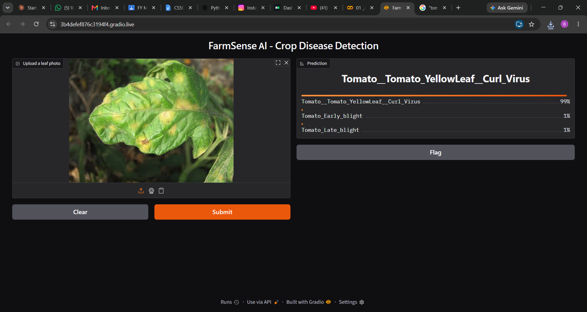
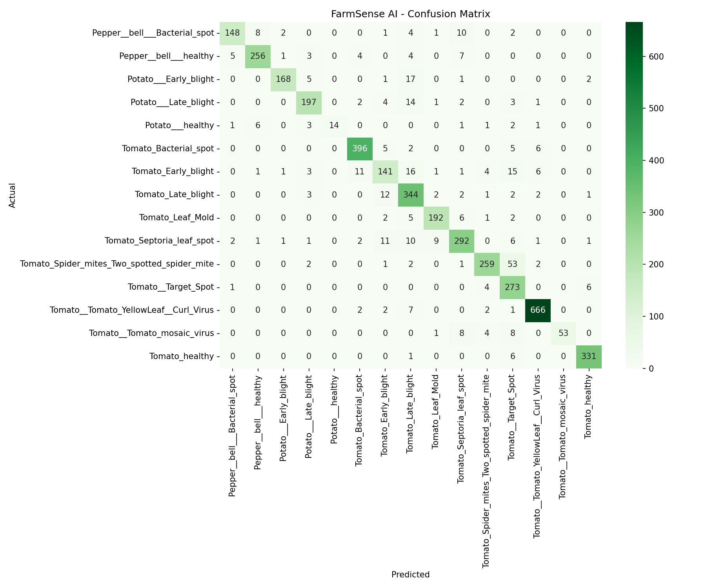

# 🌾 FarmSense AI - Crop Disease Detection

A deep learning model that identifies crop leaf diseases from a photo,
built to help farmers detect problems early.

## Demo


## Problem
Crop diseases reduce yield, and farmers often cannot identify them early.
FarmSense AI predicts the disease from a single leaf image.

## Dataset
[PlantVillage on Kaggle](https://www.kaggle.com/datasets/emmarex/plantdisease):
20,638 leaf images across 15 classes (Tomato, Potato, Pepper - healthy and diseased).
Split: 80% training (16,511) / 20% validation (4,127).

## Approach
- Images resized to 128x128 and normalized
- Custom CNN: 3 Conv2D + MaxPooling blocks, Dense(128), softmax output
- Optimizer: Adam | Loss: sparse categorical crossentropy | 5 epochs
- Built with TensorFlow/Keras on Google Colab

## Results
| Metric | Value |
|---|---|
| Training accuracy | 95.3% |
| Validation accuracy | 90.4% (peak 91.1%) |

## Evaluation
Per-class evaluation on the 4,127-image validation set (macro F1: 0.874).



**Best classes:** Tomato Yellow Leaf Curl Virus (F1 0.976), Tomato healthy (0.975), Tomato Bacterial spot (0.953).

**Weakest classes:** Potato healthy (recall 0.48, only 29 validation images), Tomato mosaic virus (recall 0.72, 74 images), Tomato early blight (F1 0.74).

**Observations:**
- The dataset is imbalanced (74 to 680 images per class), so rarer classes perform worse.
- Visually similar diseases get confused, e.g. Spider mites predicted as Target Spot, and Early blight vs Late blight.
- Next steps: class weighting, data augmentation, and transfer learning (MobileNetV2).
  
## How to run
```bash
git clone https://github.com/YOUR-USERNAME/FarmSense-AI.git
cd FarmSense-AI
pip install -r requirements.txt
python app.py
```
Then open the local link shown in the terminal and upload a leaf photo.

## Limitations
- Trained on clean, lab-style leaf images; accuracy may drop on field photos
- Covers 15 classes only (Tomato, Potato, Pepper)

## Future Work
- Fine-tune with transfer learning (MobileNet) for higher accuracy
- Train on real field images
- Crop recommendation and price prediction modules
- Marathi-language interface for farmers

## Tech Stack
Python, TensorFlow/Keras, Gradio, Google Colab
